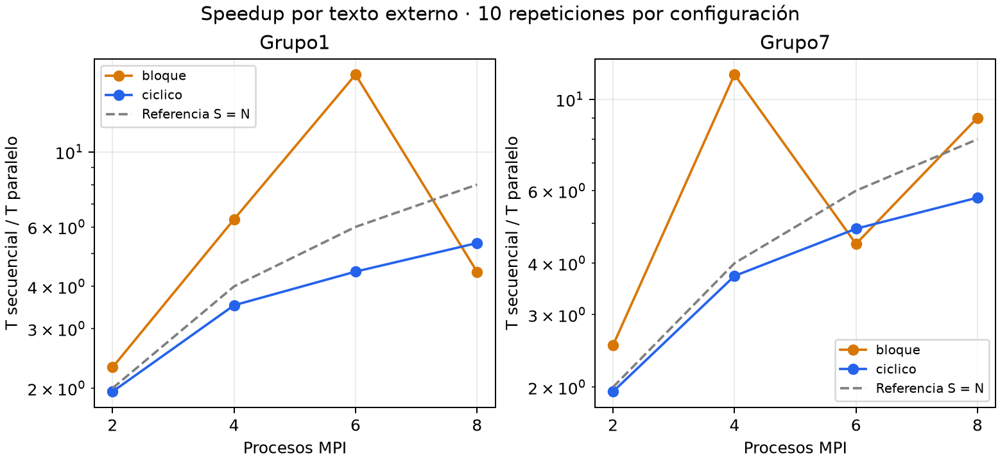
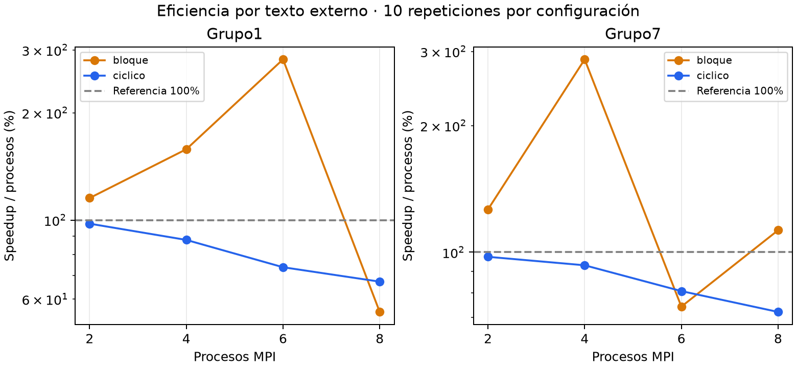
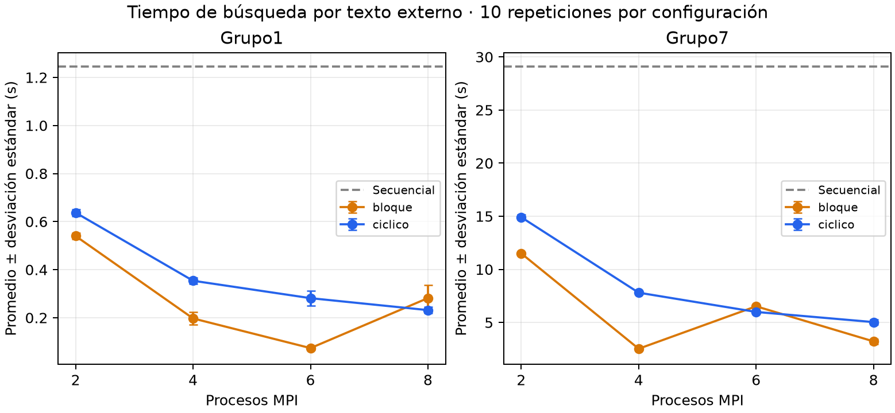

# Evidencia de descifrado y rendimiento de otros grupos

Seleccionamos los grupos **1 y 7**, usando los archivos originales y los rangos publicados en Canvas. Ambos se descifraron y las frases se verificaron también mediante OpenSSL DES-ECB independiente. Las llaves se descubrieron mediante fuerza bruta; no fueron suministradas por los autores.

## Archivos y resultados

| Grupo | Archivo | Bytes | Frase exacta | Rango exclusivo | Llave efectiva | DES hexadecimal |
|---|---|---:|---|---|---:|---|
| 1 | equipo1_mensaje.bin | 816 | quetzal sincronizado en MPI | [0, 200000) | 173421 | da94150101010101 |
| 7 | textoGrupo7.bin | 992 | se le olvida como manejar | [0, 4194304) | 3412587 | d649a10201010101 |

## Método

Por texto se ejecutaron **diez repeticiones de nueve configuraciones**: secuencial y MPI con bloques/cíclico y 2, 4, 6 y 8 procesos. Esto produce **90 mediciones por texto**, 180 en total, más 18 calentamientos excluidos de los promedios. Los procesos se variaron en pasos de dos y las repeticiones se intercalaron en orden aleatorio reproducible. Cada archivo mantuvo el mismo texto, frase y rango en todas sus comparaciones.

Se usó el mismo Apple M2 con ocho núcleos físicos, compilación `-O2`, OpenMPI 5.0.11, sin sobresuscripción y sin afinidad fija. Las configuraciones de cada texto se ejecutaron una a la vez; el grupo 1 se completó antes del grupo 7. El modo de bajo consumo estaba activado; se guardaron registros de energía y carga. No se controló la carga de otras aplicaciones.

Speedup = promedio del tiempo secuencial / promedio del tiempo paralelo. Eficiencia = speedup / número de procesos; en la tabla se expresa como porcentaje. Se usan tiempos internos de búsqueda, excluyendo arranque MPI, lectura y difusión inicial. Los tiempos externos también se conservaron. La desviación estándar es muestral y no equivale a un intervalo de confianza.

## Tiempos, speedup y eficiencia

| Texto | Reparto | Procesos | Promedio (s) | Desviación (s) | Speedup | Eficiencia |
|---|---|---:|---:|---:|---:|---:|
| grupo1 | secuencial | 1 | 1.244799 | 0.023157 | 1.00× | 100.0% |
| grupo1 | bloque | 2 | 0.539938 | 0.012056 | 2.31× | 115.3% |
| grupo1 | ciclico | 2 | 0.637162 | 0.014382 | 1.95× | 97.7% |
| grupo1 | bloque | 4 | 0.197018 | 0.026896 | 6.32× | 158.0% |
| grupo1 | ciclico | 4 | 0.353849 | 0.014125 | 3.52× | 87.9% |
| grupo1 | bloque | 6 | 0.073513 | 0.008151 | 16.93× | 282.2% |
| grupo1 | ciclico | 6 | 0.281383 | 0.030552 | 4.42× | 73.7% |
| grupo1 | bloque | 8 | 0.281688 | 0.055122 | 4.42× | 55.2% |
| grupo1 | ciclico | 8 | 0.231653 | 0.013002 | 5.37× | 67.2% |
| grupo7 | secuencial | 1 | 29.080400 | 0.141647 | 1.00× | 100.0% |
| grupo7 | bloque | 2 | 11.504890 | 0.091494 | 2.53× | 126.4% |
| grupo7 | ciclico | 2 | 14.909250 | 0.236608 | 1.95× | 97.5% |
| grupo7 | bloque | 4 | 2.531298 | 0.125443 | 11.49× | 287.2% |
| grupo7 | ciclico | 4 | 7.808096 | 0.090870 | 3.72× | 93.1% |
| grupo7 | bloque | 6 | 6.526253 | 0.088842 | 4.46× | 74.3% |
| grupo7 | ciclico | 6 | 5.995424 | 0.095006 | 4.85× | 80.8% |
| grupo7 | bloque | 8 | 3.223020 | 0.249790 | 9.02× | 112.8% |
| grupo7 | ciclico | 8 | 5.039222 | 0.222421 | 5.77× | 72.1% |

## Análisis

Los resultados por bloques deben interpretarse junto a la posición de la llave y la cantidad de intentos. Cada cambio de procesos modifica los límites de los bloques. Una eficiencia superior al 100% indica una comparación con distinta cantidad de trabajo, no un porcentaje de utilización de CPU. El CSV conserva los intentos para sustentar este análisis.

- **Grupo 1, cíclico:** speedup de 1.95× con dos procesos a 5.37× con ocho; eficiencia de 97.7% a 67.2%. Son resultados de este archivo y este equipo.
- **Grupo 7, cíclico:** speedup de 1.95× con dos procesos a 5.77× con ocho; eficiencia de 97.5% a 72.1%. Son resultados de este archivo y este equipo.

### Cantidad de trabajo realizado

| Texto | Reparto | Procesos | Intentos totales promedio | Trabajo/seq |
|---|---|---:|---:|---:|
| grupo1 | bloque | 2 | 147354.8 | 0.8497 |
| grupo1 | ciclico | 2 | 173751.0 | 1.0019 |
| grupo1 | bloque | 4 | 96330.8 | 0.5555 |
| grupo1 | ciclico | 4 | 176783.2 | 1.0194 |
| grupo1 | bloque | 6 | 46281.4 | 0.2669 |
| grupo1 | ciclico | 6 | 181194.1 | 1.0448 |
| grupo1 | bloque | 8 | 191641.2 | 1.1051 |
| grupo1 | ciclico | 8 | 174278.8 | 1.0049 |
| grupo7 | bloque | 2 | 2632709.6 | 0.7715 |
| grupo7 | ciclico | 2 | 3411970.8 | 0.9998 |
| grupo7 | bloque | 4 | 1071416.8 | 0.3140 |
| grupo7 | ciclico | 4 | 3416526.2 | 1.0012 |
| grupo7 | bloque | 6 | 3700672.0 | 1.0844 |
| grupo7 | ciclico | 6 | 3419478.6 | 1.0020 |
| grupo7 | bloque | 8 | 2135967.2 | 0.6259 |
| grupo7 | ciclico | 8 | 3409281.2 | 0.9990 |

Trabajo/seq compara intentos totales paralelos con llave + 1 (el trabajo secuencial). Puede ser menor o mayor que uno porque los ranks recorren zonas distintas y se detienen cuando llega STOP. Es evidencia necesaria para interpretar los speedups aparentes.

La comparación entre textos no aísla una única variable: tienen tamaños, llaves y rangos diferentes. Cada speedup usa la referencia secuencial de su propio texto. Estos experimentos cumplen el mínimo de diez pruebas por cada uno de dos textos externos y lo amplían a diez repeticiones por configuración.

Las gráficas de speedup y eficiencia usan escala logarítmica. Las barras de error de tiempos muestran desviación estándar. Se incluyen versiones PDF.

## Evidencia y procedencia

- `textos_otros_grupos/README.md`: transcripción de las publicaciones de los grupos 1 y 7 en Canvas.
- `fuentes.json`: frases, rangos, llaves y SHA-256 de archivos originales.
- `grupo1/` y `grupo7/`: tiempos individuales, resúmenes, 99 logs por texto, entorno y condiciones.
- `descifrado-grupo1.raw` y `descifrado-grupo7.raw`: descifrado independiente con relleno original.
- Copias `.txt`: texto legible; se retira el relleno de tres bytes `0x03` del grupo 1 y de tres bytes nulos del grupo 7.
- `mediciones.csv` y `resumen.csv`: datos reunidos únicamente de los grupos 1 y 7.
- `validacion-final.json`: integridad de repeticiones, archivos, textos y cálculos.

El informe final se encuentra en `informe/Informe_Proyecto2_MPI.pdf`.
