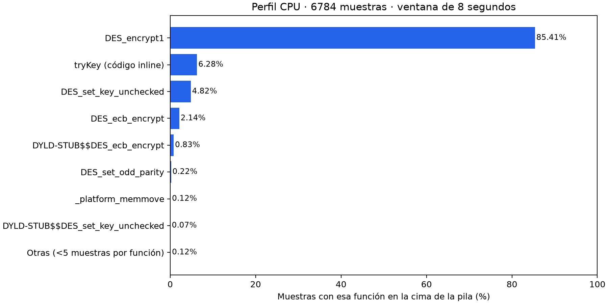
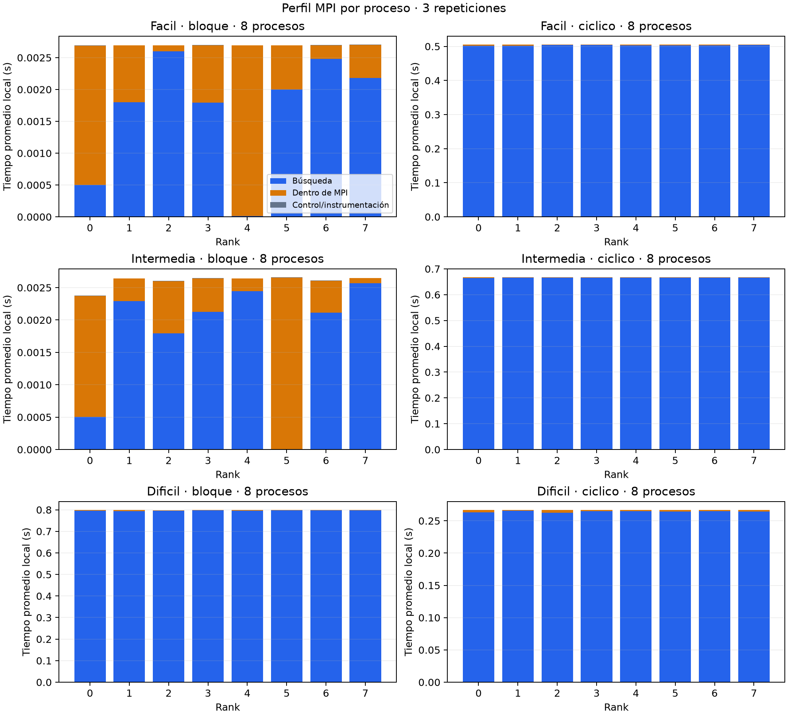
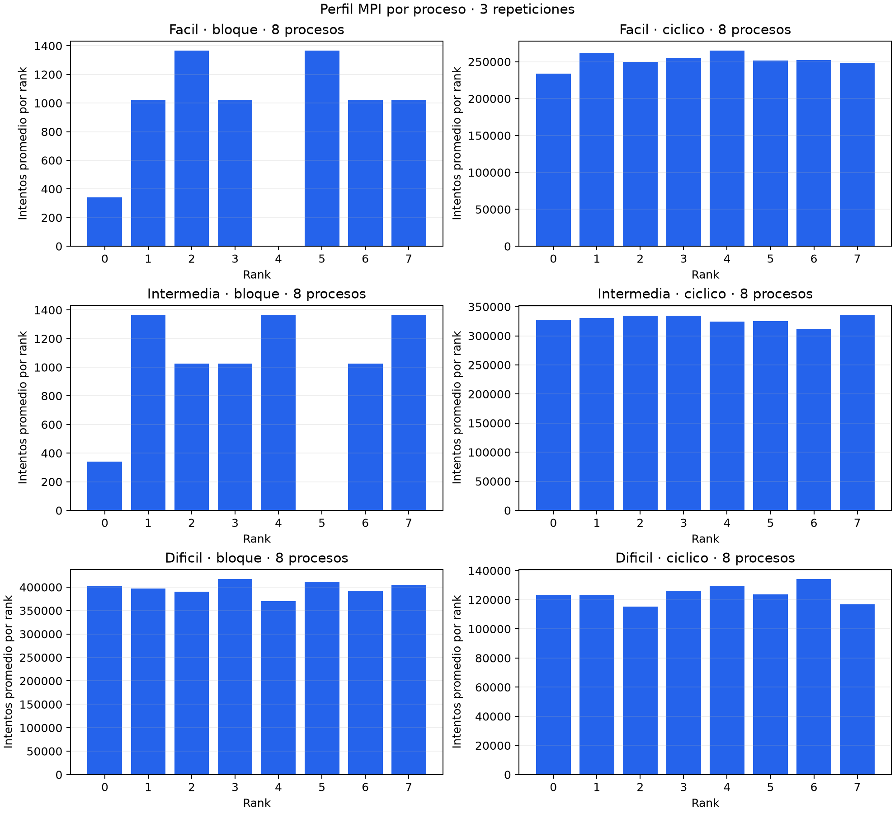

# Análisis de profiling

Esta sección técnica se incorporará después al informe final. El profiling se realizó el 14 de octubre de 2026, separado de las corridas de rendimiento.

## Método

Se obtuvo una muestra CPU de ocho segundos con `sample` de macOS (intervalo solicitado 1 ms), y se ejecutaron 72 perfiles MPI (3 repeticiones de 24 configuraciones), generando 360 registros por proceso. Los binarios instrumentados se compilaron con `-O2 -g`. El secuencial no agrega timers por llave. El MPI usa una capa PMPI y timers por lote.

CPU: texto propio, palabra `jacaranda`, rango `2^24`, llave 16777215. MPI: mismo texto, rango `2^22`, llaves fácil 2097153, intermedia 2621440 y difícil 921826; bloques y cíclico, procesos 2, 4, 6 y 8. Las ejecuciones MPI se realizaron una a la vez en orden aleatorio reproducible, sin sobresuscripción y sin fijar afinidad. No hubo calentamientos separados en esta corrida de profiling.

Se registraron energía y carga. El modo de bajo consumo estaba activado. No se controlaron otras aplicaciones. Las mediciones se limitan al equipo local y no representan un perfil de transferencia en una red entre máquinas.

## Funciones que concentran el costo

La ventana de muestreo produjo **6784 muestras**. La tabla usa la función en la cima de la pila (muestras exclusivas), evitando sumar padres e hijos de una misma pila.

| Función | Muestras | Porcentaje |
|---|---:|---:|
| DES_encrypt1 | 5794 | 85.41% |
| tryKey (código inline) | 426 | 6.28% |
| DES_set_key_unchecked | 327 | 4.82% |
| DES_ecb_encrypt | 145 | 2.14% |
| DYLD-STUB$$DES_ecb_encrypt | 56 | 0.83% |
| DES_set_odd_parity | 15 | 0.22% |
| _platform_memmove | 8 | 0.12% |
| DYLD-STUB$$DES_set_key_unchecked | 5 | 0.07% |
| Otras (<5 muestras por función) | 8 | 0.12% |

**El principal costo observado es DES:** `DES_encrypt1` aparece en 85.41% de las muestras. Es la rutina interna utilizada al procesar bloques, incluso durante descifrado. La preparación del calendario de la llave (`DES_set_key_unchecked`) tiene un costo menor. Copias de memoria y paridad aparecen con proporciones pequeñas en este texto.

Las rutinas inline de copia, preparación y búsqueda pueden quedar atribuidas a `tryKey`; no se asigna todo ese porcentaje únicamente al substring. Los porcentajes son estimaciones de muestreo de una ventana, no tiempos exactos ni un perfil del ciclo completo.

## Actividad MPI

Los porcentajes siguientes usan la suma de tiempos locales de todos los ranks y repeticiones (tiempo acumulado por proceso). No son porcentajes del tiempo global de pared. El tiempo máximo por ejecución se promedia por separado. La columna trabajo compara intentos totales con los intentos secuenciales esperados (llave + 1).

| Caso | Modo | Procesos | Máx. rank promedio (s) | Búsqueda | Dentro de MPI | Trabajo/seq |
|---|---|---:|---:|---:|---:|---:|
| dificil | bloque | 2 | 1.328134 | 99.95% | 0.04% | 2.0020 |
| dificil | bloque | 4 | 1.394846 | 99.92% | 0.08% | 3.9874 |
| dificil | bloque | 6 | 0.393861 | 99.61% | 0.38% | 1.4295 |
| dificil | bloque | 8 | 0.798922 | 99.67% | 0.32% | 3.4553 |
| dificil | ciclico | 2 | 0.667245 | 99.95% | 0.05% | 0.9999 |
| dificil | ciclico | 4 | 0.356700 | 99.66% | 0.33% | 1.0024 |
| dificil | ciclico | 6 | 0.286723 | 99.63% | 0.36% | 1.0072 |
| dificil | ciclico | 8 | 0.266691 | 99.11% | 0.88% | 1.0762 |
| facil | bloque | 2 | 0.001073 | 49.09% | 50.58% | 0.0003 |
| facil | bloque | 4 | 0.002536 | 60.14% | 39.78% | 0.0020 |
| facil | bloque | 6 | 0.003257 | 65.11% | 34.80% | 0.0033 |
| facil | bloque | 8 | 0.002705 | 61.93% | 37.93% | 0.0034 |
| facil | ciclico | 2 | 1.500552 | 99.94% | 0.05% | 1.0003 |
| facil | ciclico | 4 | 0.782705 | 99.86% | 0.13% | 0.9992 |
| facil | ciclico | 6 | 0.609863 | 99.79% | 0.20% | 1.0042 |
| facil | ciclico | 8 | 0.505028 | 99.65% | 0.34% | 0.9622 |
| intermedia | bloque | 2 | 0.759292 | 99.92% | 0.07% | 0.4005 |
| intermedia | bloque | 4 | 0.827287 | 99.84% | 0.15% | 0.8033 |
| intermedia | bloque | 6 | 0.933600 | 99.82% | 0.17% | 1.2135 |
| intermedia | bloque | 8 | 0.002663 | 66.48% | 33.39% | 0.0029 |
| intermedia | ciclico | 2 | 1.894692 | 99.94% | 0.05% | 1.0004 |
| intermedia | ciclico | 4 | 0.998508 | 99.90% | 0.10% | 1.0005 |
| intermedia | ciclico | 6 | 0.820755 | 99.82% | 0.18% | 1.0031 |
| intermedia | ciclico | 8 | 0.667066 | 99.78% | 0.21% | 1.0010 |

## Hallazgos e interpretación

1. **La búsqueda domina el reparto cíclico:** en las configuraciones medidas representa al menos 99.11% del tiempo acumulado por proceso; las llamadas MPI representan como máximo 0.88%. Esto indica que las esperas registradas dentro de MPI no dominan estas búsquedas locales. No mide ni descarta contención de CPU o memoria.
2. **Los speedups aparentes de bloques se explican por menos trabajo.** La columna trabajo/seq permite ver las diferencias de candidatos evaluados. Para llaves al inicio de un bloque, el ganador hace muy pocos intentos y los otros procesos reciben STOP. Con ciertos repartos también se trabaja más que en el secuencial, porque otros ranks exploran simultáneamente zonas posteriores a la solución.
3. **Se puede observar el reparto real por rank.** Los CSV y gráficas muestran que los intentos no son necesariamente iguales: intervienen la posición de la solución, el desempeño efectivo de cada proceso y cuándo se atiende STOP. La terminación es por lotes de hasta 1024 candidatos, por lo que un proceso puede completar su lote antes de detenerse.
4. **Los perfiles muy cortos están afectados por el costo fijo de coordinación.** En casos de solución inmediata, unos microsegundos o milisegundos de espera pueden representar un porcentaje grande; no extrapolar esa proporción a búsquedas largas.
5. **El perfil no demuestra una única causa para la eficiencia menor con ocho procesos.** No se identificaron los núcleos asignados ni se midieron contadores de memoria. La combinación de núcleos, planificación, competencia por recursos y trabajo extra debe considerarse como hipótesis, no como causa comprobada.
6. **Prioridades de optimización futuras:** mantener el reparto cíclico para consistencia, revisar primero el costo de DES por candidato y, si se cambia el tamaño de lote, medir el equilibrio entre atención a MPI y trabajo extra antes de detenerse. No se modificó el algoritmo de búsqueda como parte de este profiling.

## Alcance y evidencia

- `cpu-sample.txt`: árbol de llamadas y muestras originales.
- `cpu_resumen.csv`: porcentajes derivados de muestras exclusivas.
- `perfiles.csv`: todos los perfiles por rank, con tiempos y conteos por llamada MPI.
- `resumen_mpi.csv`: resúmenes por caso, modo y procesos.
- CSV individuales y logs: evidencia de cada ejecución y de las llaves encontradas.
- `entorno.json`, registros de energía/carga y comandos CPU: reproducción.
- Gráficas en PNG y PDF para incorporación posterior al informe.
- `validacion.json`: integridad de ranks, resultados y partición de tiempos.

El tiempo dentro de MPI incluye envío, progreso y posibles esperas; no es tiempo puro de red. La instrumentación agrega costo y estos tiempos no reemplazan los speedups obtenidos sin instrumentación. Los perfiles excluyen arranque, lectura, difusión inicial, barrera inicial, impresión y recolección de perfiles. No se calculó una penalización exacta de instrumentación mediante corridas pareadas.

Reproducción: consultar `benchmarks/PROFILING.md`. El informe final está en `informe/Informe_Proyecto2_MPI.pdf`; la evidencia de los grupos 1 y 7 está en `resultados/otros-grupos-2026-10-14/`.

## Verificación funcional

Pasaron `make test`, `make test-sync` y la suite de integración usando el binario MPI instrumentado: 173 ejecuciones en cada suite, además de las pruebas internas de DES. Se conserva la salida en `regresiones.log`.
