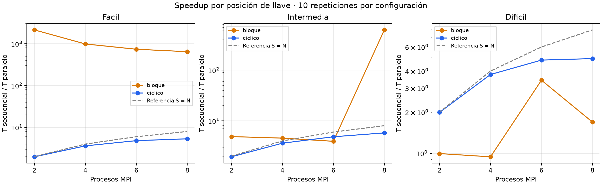
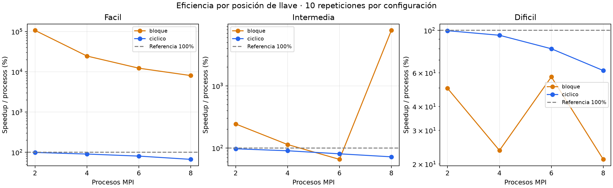
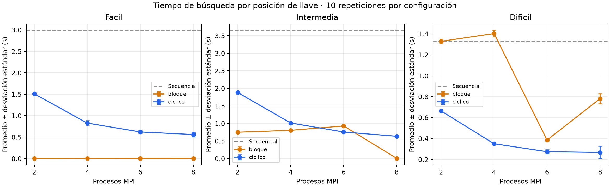

# Rendimiento: diez repeticiones y 2, 4, 6 y 8 procesos

Corrida realizada el 14 de octubre de 2026 en el equipo local. Se completaron **270 mediciones** (27 configuraciones × 10 repeticiones), además de **27 calentamientos**. Todas recuperaron la llave esperada. El profiling se realizó por separado y está en `resultados/profiling-2026-10-14/`.

## Metodología

- Apple M2, ocho núcleos físicos, macOS 26.2, OpenMPI 5.0.11 y compilación C++17 con `-O2`.
- Texto propio `prueba.txt`, palabra `jacaranda`, rango exclusivo `[0, 4194304)` (`2^22`).
- Llaves: fácil 2097153; intermedia 2621440; difícil 921826. Las denominaciones se refieren a los casos de la actividad 9 adaptados al rango reducido y a cuatro procesos por bloques.
- Una ejecución de calentamiento por configuración; diez medidas en orden aleatorio reproducible por caso. Los casos se ejecutaron en orden fácil, intermedia y difícil.
- Ejecuciones una a la vez, sin sobresuscripción, con procesos 2, 4, 6 y 8, sin afinidad fija.
- Speedup = promedio secuencial / promedio paralelo; eficiencia = speedup / procesos. Los promedios usan los tiempos internos de búsqueda, excluyendo arranque MPI, lectura y difusión inicial. El costo externo se conserva en el CSV.
- Modo de bajo consumo activado. El sistema informó alimentación AC al inicio. No se controló la carga de otras aplicaciones ni se fijó afinidad a núcleos específicos; consultar registros de energía y carga.
- Son mediciones sobre tres cifrados controlados del texto del equipo; no sustituyen las pruebas requeridas de dos grupos externos ni un recorrido completo de `2^56`.

## Línea base secuencial

| Caso | Promedio (s) | Desviación estándar (s) | Llaves probadas |
|---|---:|---:|---:|
| facil | 2.993120 | 0.075385 | 2097154 |
| intermedia | 3.654003 | 0.015366 | 2621441 |
| dificil | 1.322504 | 0.112231 | 921827 |

## Comparación paralela

La eficiencia se muestra en porcentaje. Valores superiores al 100% en bloques reflejan búsquedas que realizaron mucho menos trabajo que el secuencial; no representan utilización de CPU.

| Caso | Reparto | Procesos | Promedio (s) | Desviación (s) | Speedup | Eficiencia |
|---|---|---:|---:|---:|---:|---:|
| facil | bloque | 2 | 0.001400 | 0.000487 | 2138.40× | 106920.1% |
| facil | ciclico | 2 | 1.509150 | 0.023941 | 1.98× | 99.2% |
| facil | bloque | 4 | 0.003034 | 0.000742 | 986.43× | 24660.7% |
| facil | ciclico | 4 | 0.826796 | 0.061229 | 3.62× | 90.5% |
| facil | bloque | 6 | 0.004054 | 0.002539 | 738.28× | 12304.6% |
| facil | ciclico | 6 | 0.620030 | 0.029224 | 4.83× | 80.5% |
| facil | bloque | 8 | 0.004638 | 0.002798 | 645.39× | 8067.4% |
| facil | ciclico | 8 | 0.560383 | 0.052296 | 5.34× | 66.8% |
| intermedia | bloque | 2 | 0.749585 | 0.006701 | 4.87× | 243.7% |
| intermedia | ciclico | 2 | 1.881685 | 0.021302 | 1.94× | 97.1% |
| intermedia | bloque | 4 | 0.803519 | 0.024809 | 4.55× | 113.7% |
| intermedia | ciclico | 4 | 1.012417 | 0.031663 | 3.61× | 90.2% |
| intermedia | bloque | 6 | 0.928373 | 0.028435 | 3.94× | 65.6% |
| intermedia | ciclico | 6 | 0.755889 | 0.025231 | 4.83× | 80.6% |
| intermedia | bloque | 8 | 0.005837 | 0.004516 | 625.96× | 7824.6% |
| intermedia | ciclico | 8 | 0.633722 | 0.027167 | 5.77× | 72.1% |
| dificil | bloque | 2 | 1.328581 | 0.022701 | 1.00× | 49.8% |
| dificil | ciclico | 2 | 0.663682 | 0.009723 | 1.99× | 99.6% |
| dificil | bloque | 4 | 1.402926 | 0.031332 | 0.94× | 23.6% |
| dificil | ciclico | 4 | 0.350533 | 0.009448 | 3.77× | 94.3% |
| dificil | bloque | 6 | 0.385773 | 0.009646 | 3.43× | 57.1% |
| dificil | ciclico | 6 | 0.274966 | 0.019303 | 4.81× | 80.2% |
| dificil | bloque | 8 | 0.781097 | 0.046477 | 1.69× | 21.2% |
| dificil | ciclico | 8 | 0.268070 | 0.058509 | 4.93× | 61.7% |

## Interpretación

1. **El reparto cíclico es más consistente entre las posiciones estudiadas.** Con cuatro procesos sus speedups fueron 3.62×, 3.61× y 3.77×; por bloques fueron 986.43×, 4.55× y 0.94×. Esta conclusión se limita a estos textos, llaves y condiciones.
2. **La llave fácil muestra la dependencia del trabajo realizado.** Con dos procesos por bloques el speedup aparente fue 2138.40×: la solución se encuentra al principio del segundo bloque. El secuencial prueba 2097154 llaves, mientras bloques puede detenerse después de unos pocos lotes. Los tiempos extremadamente cortos también tienen alta variación relativa.
3. **La dificultad cambia al variar procesos.** La llave intermedia coincide con el inicio de un bloque con ocho procesos y produce 625.96×. No es una aceleración proporcional de una carga fija.
4. **Aumentar procesos reduce la eficiencia cíclica.** Con dos procesos fue aproximadamente 97–100%; con ocho fue 62–72%. El speedup con ocho procesos llegó a 4.93–5.77×. Estas mediciones no identifican por sí solas la causa: comunicación, reparto del trabajo y asignación a núcleos serán temas del profiling.
5. **Se conservaron todas las mediciones, incluidas las más lentas.** El caso difícil secuencial incluyó una ejecución de 1.63969 s frente a una media de 1.322504 s. No se descartaron valores sin un criterio previo. La desviación y los extremos están disponibles en `resumen.csv`.

## Gráficas







Las gráficas de speedup y eficiencia usan escala logarítmica para mostrar simultáneamente valores cercanos a uno y los speedups aparentes de bloques. Las barras de error de tiempos representan desviación estándar, no intervalos de confianza. Se incluyen versiones PDF para el informe.

## Evidencia y reproducción

- `mediciones.csv`: 270 tiempos, intentos, comandos y tiempos externos.
- `resumen.csv`: 27 resúmenes de diez repeticiones.
- `entorno.json`: versiones, equipo, límite, commit y hashes de ejecutables y texto.
- `validacion.json`: comprobación de integridad y consistencia de resultados.
- `*.log`: 297 salidas completas de búsquedas; repetición 0 corresponde a calentamiento.
- `ejecucion.log`: avance completo de la ejecución.
- `energia-inicio.txt`, `energia-final.txt`, `carga-inicio.txt`, `carga-final.txt`: condiciones observadas.

```sh
make
python3 benchmarks/medir.py --salida resultados/nueva-corrida --limite 4194304 --repeticiones 10 --procesos 2 4 6 8
python3 benchmarks/graficar.py resultados/nueva-corrida
```

Los cifrados `.bin` existen en esta carpeta, pero la regla global de `.gitignore` los excluye del control de versiones; deben incluirse al preparar el paquete de entrega.

Pendientes posteriores: profiling, experimentos con al menos dos textos externos y confirmación de la adaptación del rango reducido con el docente.
